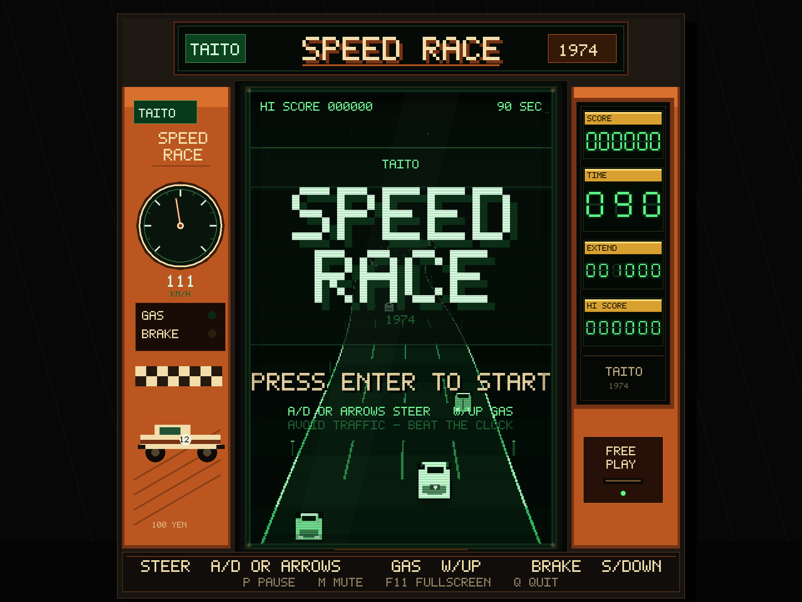
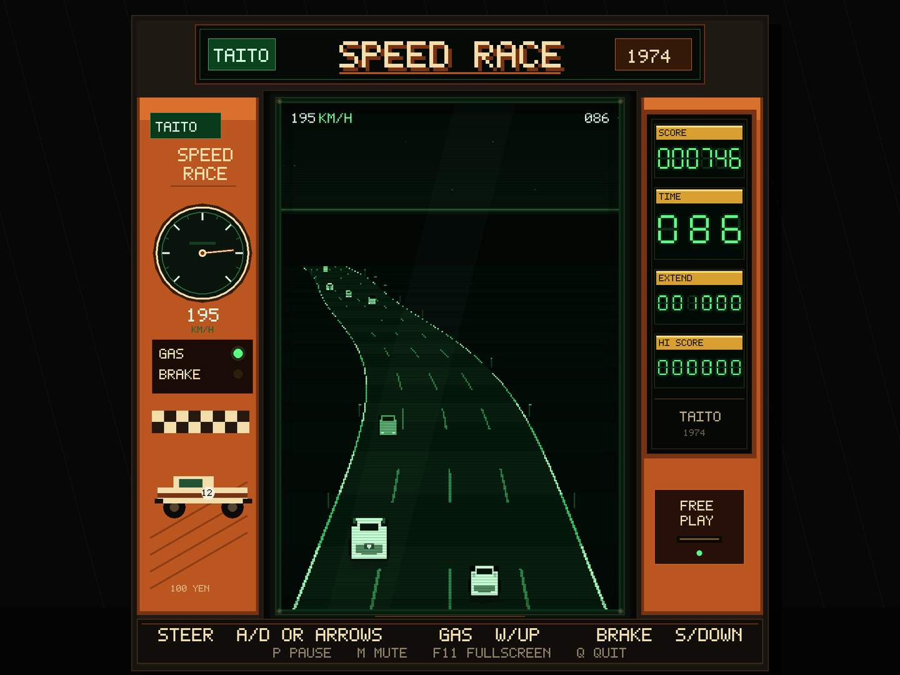

# SPEED RACE (1974)

A clean-room Rust tribute to Taito's **Speed Race** — the 1974 upright that
took the electro-mechanical driving-game idea and made the road scroll on a
video screen. Green phosphor, bad news traffic, and a ninety-second clock.



Everything you see and hear is generated at runtime: the cabinet, the CRT
scanlines, the pixel font, the seven-segment scoreboard, the cars and the
engine noise. There are no image, font or audio assets in the repository.

## Run it

```sh
cargo run --release
```

Requires a recent stable Rust toolchain (edition 2024). Tested on macOS;
macroquad and gilrs also target Linux and Windows.

The game opens in a resizable 4:3 window. **F11** toggles fullscreen.

## Controls

| Action | Keyboard | Wheel / gamepad |
| --- | --- | --- |
| Start / race again | **Enter** or **Space** | **A** / South |
| Steer | **A D** or **← →** | Left stick / wheel, d-pad |
| Accelerate | **W** / **↑** / **Space** | Right trigger, **A**, d-pad up |
| Brake | **S** / **↓** | Left trigger, **B**, d-pad down |
| Pause | **P** or **Esc** | **Start** |
| Mute | **M** | — |
| Fullscreen | **F11** | — |
| Screenshot | **F12** | — |
| Quit | **Q** | Select / Back |

F12 writes `speed-race-screenshot.png` next to the game.

## The game

- **90 seconds on the clock.** Drive as far as you can before it reaches zero.
- **Four lanes of traffic.** Rival cars are slower than you; overtake them for
  points. Faster passes are worth more.
- **One hit hurts.** A collision spins the car, zeros your speed and restarts
  the track. The clock never stops.
- **Extend the clock.** Cross a score threshold (first at 1,000 points) and
  twenty seconds are added. Later thresholds climb.
- **High score.** Persisted to `~/.speed_race_1974_highscore`.

The cabinet's side panel shows the score, time, next extend target, best score
and a live analog speedometer. The top of the CRT carries a minimal
speed/time readout so you do not have to look away for long.



## What is under the hood

| File | Purpose |
| --- | --- |
| `src/main.rs` | window, frame loop, cameras, screenshot, high-score file |
| `src/game.rs` | deterministic simulation: phases, traffic, scoring, crashes |
| `src/road.rs` | pseudo-3D projection and the endless curved centre line |
| `src/gfx.rs` | bitmap font, seven-segment LEDs, cars, CRT, cabinet |
| `src/audio.rs` | procedural engine loops and arcade one-shots |
| `src/input.rs` | keyboard plus analog wheel/gamepad support |
| `src/rng.rs` | tiny xorshift RNG |

The game is drawn at a deliberate **240 × 360** internal resolution into a
render target, then scaled with nearest-neighbour sampling inside a cabinet
that is composed on a 960 × 720 virtual canvas. That keeps the chunky 1974
look while letting the cabinet chrome stay sharp on modern displays.

The simulation is independent of macroquad and takes a `Controls` snapshot
plus a delta time. Events (countdown beep, overtake, crash, extension, game
over) are drained by the app, which owns the sound. That separation is why the
rules can be tested without opening a window.

```sh
cargo test
cargo clippy --all-targets -- -D warnings
```

The game code contains no `unsafe` blocks.

## Authenticity notes

This is an original tribute, not an emulation and not affiliated with Taito.
The interpretation includes:

- a vertical, endlessly scrolling road with perspective;
- separate score/time/extension displays beside the tube, as on the upright;
- a 90-second run extended by score;
- speed-scaled overtaking points;
- a crash that resets speed and puts the car back at the start;
- monochrome-green display, scanlines, glass reflection and CRT vignette.

The four-lane layout, procedural curves and modern gamepad support are
liberties taken for playability.

---

## Working on the game

- [AGENTS.md](AGENTS.md) — handoff contract and verification gates for agent sessions
- [CONTRIBUTING.md](CONTRIBUTING.md) — contributor workflow and house rules
- [docs/ARCHITECTURE.md](docs/ARCHITECTURE.md) — system design and rendering invariants
- [docs/DECISIONS.md](docs/DECISIONS.md) — architecture decision records

Taito's *Speed Race* (1974), designed by Tomohiro Nishikado, was distributed
internationally as *Racer* and *Wheels*.
