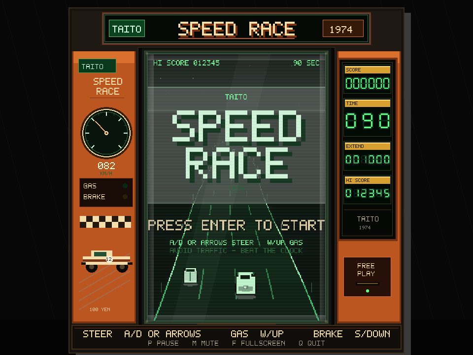
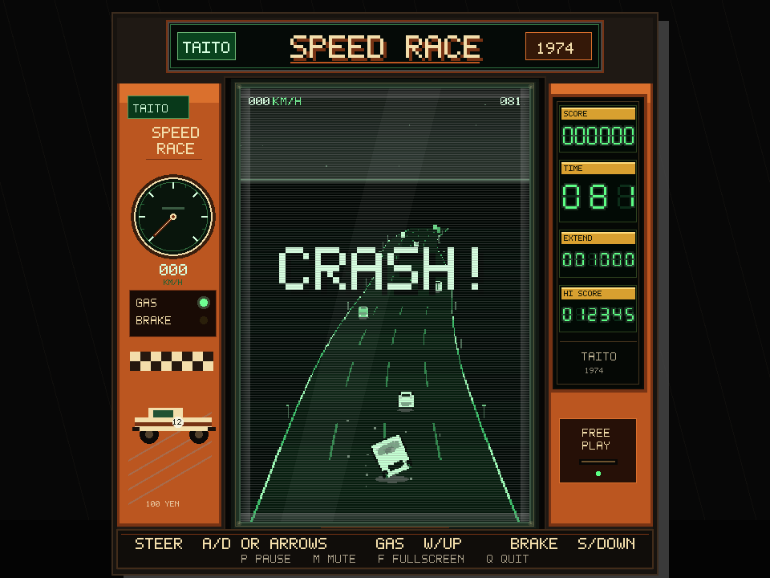

# SPEED RACE (1974) — Swift + Metal port

A Swift port of the canonical Rust game in the repository root
(`src/`, pinned at `d5f4420`), using Metal for rendering. Every pixel and every
sample is generated in code; there are no image, font or audio assets.

The Rust game is the reference implementation. Behavioural parity is enforced by
a golden-trace harness that replays fixtures produced by the real Rust `Game`
and compares f32 values as raw bit patterns.



## Run it

```sh
cd rewritten-in-swift
swift run speed-race-app          # play
./tools/check.sh                  # gate: format lint, warnings-as-errors build, 22 checks
swift run speed-race-render       # write docs screenshots headlessly
```

Requires macOS 14+ and a Swift 6 toolchain. No third-party dependencies.

## Controls

| Action | Keyboard | Wheel / gamepad |
| --- | --- | --- |
| Start / race again | **Enter** or **Space** | **A** / South |
| Steer | **A D** or **← →** | Left stick / wheel axis, d-pad |
| Accelerate | **W** / **↑** / **Space** | Right trigger, **A**, d-pad up |
| Brake | **S** / **↓** | Left trigger, **B**, d-pad down |
| Pause | **P** or **Esc** | Menu / Start |
| Mute | **M** | — |
| Fullscreen | **F** | — |
| Screenshot | **F12** | writes `speed-race-swift-screenshot.png` |
| Quit | **Q** | — |

The first connected controller is used, with a 0.12 stick dead zone, matching
`src/input.rs`. Hot-plugging is handled by the GameController framework.

The mouse is never captured or hidden.



## Layout

| Path | Responsibility |
| --- | --- |
| `Sources/SpeedRace/Port/Game.swift` | rules, traffic, scoring, crashes (port of `game.rs`) |
| `Sources/SpeedRace/Port/Road.swift` | pseudo-3D projection and centre line (`road.rs`) |
| `Sources/SpeedRace/Port/Rng.swift` | deterministic xorshift RNG (`rng.rs`) |
| `Sources/SpeedRace/Port/Input.swift` | keyboard state and key map (`input.rs`) |
| `Sources/SpeedRace/Render/` | draw list, CPU triangulation, Metal renderer |
| `Sources/SpeedRace/Support/AudioEngine.swift` | continuous engine synth and one-shots (`audio.rs`) |
| `Sources/SpeedRace/Support/` | PNG encoder, Rust-numeric helpers, high score, screenshots |
| `Sources/SpeedRaceApp/` | AppKit window, MTKView, frame loop |
| `Tests/ParityCheck/` | ported unit tests and the golden-trace gate |
| `Fixtures/parity/` | fixtures generated from the canonical Rust game |
| `tools/parity-gen/` | generator (copies Rust modules verbatim into a scratch crate) |

## Documents

- [DECISIONS.md](docs/DECISIONS.md) — architecture decision records
- [DIVERGENCES.md](docs/DIVERGENCES.md) — every intentional difference from Rust
- [PARITY](docs/INVESTIGATION-parity.md) — how parity is proven, and what it cost
- [PORTING-JOURNEY.md](docs/PORTING-JOURNEY.md) — the complete account: timeline,
  bug catalogue, dead ends, alternatives, compromises and a reusable playbook
- [METAL-VS-PACMAN.md](docs/METAL-VS-PACMAN.md) — why the first renderer failed
- [INVESTIGATION-renderer.md](docs/INVESTIGATION-renderer.md) — the full record

## Linting and static checks

Swift ships no Clippy equivalent. The gate uses the two tools that do exist:

| Check | Tool | Catches |
| --- | --- | --- |
| `swift-format lint` | Apple's `swift-format`, bundled with the Command Line Tools | style, line length, naming, one statement per line, trailing commas |
| `swift build -Xswiftc -warnings-as-errors` | the Swift compiler | unused variables and dead stores, unreachable code, actor-isolation mistakes, deprecated API |

SwiftLint and Periphery (dead-code analysis across files) are third-party and
deliberately not required. `tools/check.sh` runs both stages plus the parity
suite; formatting is applied with
`xcrun swift-format format --in-place --recursive Sources Tests`.

## Working agreement

Commits and pushes are handled by the agent without asking; see
[DECISIONS.md](docs/DECISIONS.md) P-0015 for the exact scope and the git rules
that still apply (no force-push, no rewritten history, no build output).

## Status

Feature-complete against the canonical game: attract screen, countdown, race,
crash/restart, game over, scoreboard, engine audio and one-shot effects,
keyboard plus analog wheel/gamepad input. The high-score file is
`~/.speed_race_1974_swift_highscore`, deliberately separate from the Rust
game's.

Not ported: force feedback and configurable wheel mappings (see
[DIVERGENCES.md](docs/DIVERGENCES.md)).
